<h1>
  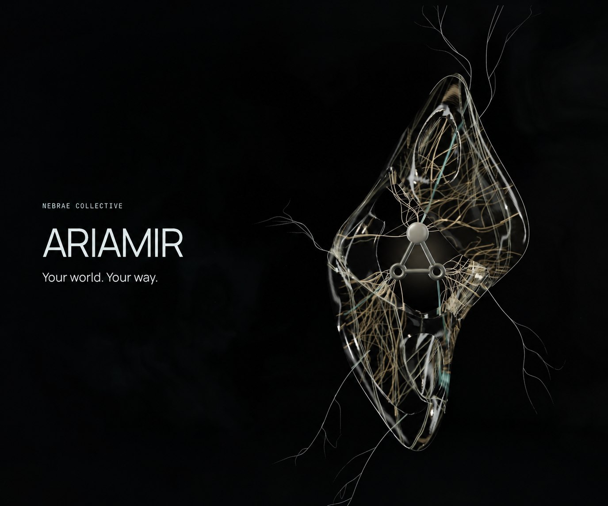
</h1>

**Local-first AI for knowledge, useful work and extensible capabilities.**

Ariamir brings models, project knowledge, documents and supervised tools into one workspace. It is built for people who want to work with their own information, review consequential actions and choose the capabilities their work needs.

> **0.19 development line · Evaluation in progress · Real workload pilot in preparation**
>
> Reviewed 2 November 2026. Ariamir is an unfinished product. Implemented features, technical validation and a stable public release are different states.

[nebrae.com](https://nebrae.com) · [Modernization plan](docs/modernization-plan.md) · [Roadmap to 1.0](docs/roadmap.md) · [Current status](docs/current-status.md) · [Capabilities](docs/capabilities.md) · [Hardware Lab](docs/hardware-lab.md) · [What's new](docs/whats-new-2026-11.md) · [Collaborate](partners/README.md)

## What “0.19” means

**0.19 is Ariamir's pre-1.0 development line.** It identifies a stage in the product's evolution, with implemented functionality and ongoing integration work. It is not a completion percentage or an announcement of a stable public release.

By this stage, Ariamir's scope extends across:

- **Models and tools:** model management, Fabric coordination and supported supervised actions.
- **Project knowledge:** connected notes, source-aware retrieval and the Graph Workspace.
- **Documents and code:** analysis, artifact preparation and supported development workflows.
- **An extensible workspace:** business modules, project data, access controls, installation, updates and supported recovery.

The 0.19 program builds on that foundation to modernize selected capabilities and validate their integration. Availability and validation depend on the build and configuration; the [dated status](docs/current-status.md) and [roadmap](docs/roadmap.md) explain the remaining work.

### Project origin and development

Gabriel Vázquez conceived Ariamir and carried out almost all of its design and development up to the 0.19 line, using AI-assisted development. As Ariamir's scope grew and came to cover much of the area addressed by AAOS, the two projects were unified. The combined project continues collaboratively within Nebrae Collective.

This development history describes the original contribution and subsequent unification. It does not mean that the entire 0.19 modernization program has completed validation.

## The modernization and integration program

**The goal is to improve Ariamir without making users start over.** We are modernizing the product capability by capability, preserving supported workflows and project data while making it easier to integrate suitable AI tools and extend the workspace.

The work builds on the 0.19 business-module platform: focused views, project data, controlled access, integrations and lifecycle support. It introduces Python selectively where there is a demonstrated benefit, while retaining existing implementations that continue to serve the product well.

Three commitments guide the program:

- **Preserve continuity.** Changes must keep supported behaviour, permissions and project data usable, with tested recovery.
- **Measure the benefit.** Assess quality, responsiveness, memory and context use across complete tasks before adopting a replacement.
- **Expand in stages.** Validate integration and a real workload first, then broaden adoption and prepare selected macOS and Linux support.

| Status | What it means today |
| --- | --- |
| **Implemented in development builds** | Business-module installation and updates, project data and access controls, backup/retirement options, assistant proposals, Knowledge and supervised tools. Availability depends on the build and configuration. |
| **Completed — representative integration** | A representative extension built through the new development path was integrated and accepted, including a 24-hour continuous run. |
| **In progress — real workload pilot** | Preparing a real AI workload as a capability on the new path, while hardening the integrated release. |
| **Planned next stages** | Selective adoption across capabilities, integrated hardening, a portable foundation, macOS/Linux enablement and public beta. |

The representative integration is complete; broad migration has not finished. Read the [public plan](docs/modernization-plan.md) for the purpose and scope, or the [dated status](docs/current-status.md) for current limits.

## Roadmap at a glance

| Release theme | Intended outcome | Status |
| --- | --- | --- |
| **0.19 · Modernization and integration** | Evolve selected capabilities while preserving the experience, data and control users rely on. | In development |
| **0.20 · Portable foundation** | Remove remaining assumptions that tie the core to Windows. | Planned; preparation underway |
| **0.21 · macOS and Linux** | Validate clean installs and core workflows on selected real configurations. | Planned |
| **0.22 · Public beta** | Test sustained third-party use and stabilize documented integrations. | Planned |
| **1.0 RC → 1.0 stable** | Deliver a supported, recoverable and extensible workspace. | Target |

These are release themes, not delivery dates or announcements of availability. The [full roadmap](docs/roadmap.md) explains the work and completion criteria for every stage.

## What you can do with Ariamir

These capabilities exist in development builds. The table describes their purpose and the work still needed, rather than promising universal availability.

| Area | Practical value | Current boundary |
| --- | --- | --- |
| **Knowledge and Graph Workspace** | Find project notes and sources, follow relationships and inspect supporting context. | Retrieval, scale, synchronization and accessibility remain under validation. |
| **Documents and code** | Read source material, prepare reports, explore code and review changes. | Output accuracy, layout and complete workflows still need QA. |
| **Assistant proposals** | Review a suggested next step before deciding what to do. | Accepting a proposal creates a plan; execution requires separate authorization. |
| **Business modules** | Add focused tools with their own workspace views and project data. | Implemented in 0.19 candidates; the platform transformation and real-module acceptance continue. |
| **Models and Fabric** | Coordinate models, tools and available compute for a task. | Capacity depends on hardware and workload; cloud inference is optional and explicitly selected. |
| **Browser, desktop and integrations** | Work through supported tools, configured services and compatible MCP clients. | Coverage, account setup and permissions vary; integration is not universal computer control. |
| **Continuity and recovery** | Keep project context, inspect progress and use supported backup/update workflows. | Recovery is tested within stated boundaries; a stable release remains pending. |

Explore the [full capability catalog](docs/capabilities.md) and [public product overview](docs/overview.md).

## Inside Ariamir — the new interface

A design preview of the new interface, captured on 13 November 2026 from a navigable prototype with sample data. It is not an installed release, and the interface text is shown in Spanish. Project names, model names, GPUs and figures are examples.

[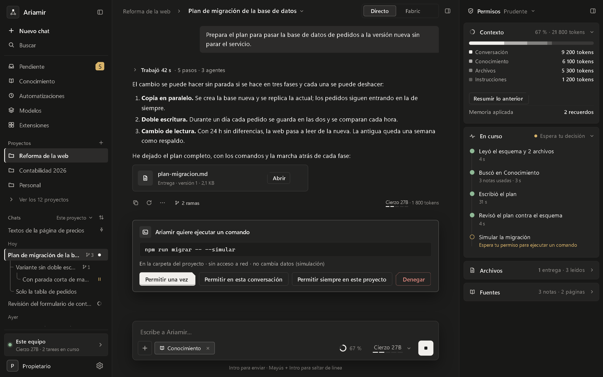](docs/interface-tour.md)

*The workspace: sidebar, conversation and conversation panel. When Ariamir needs permission to run a command, a card explains what it wants and offers four choices.*

### Agent Fabric

[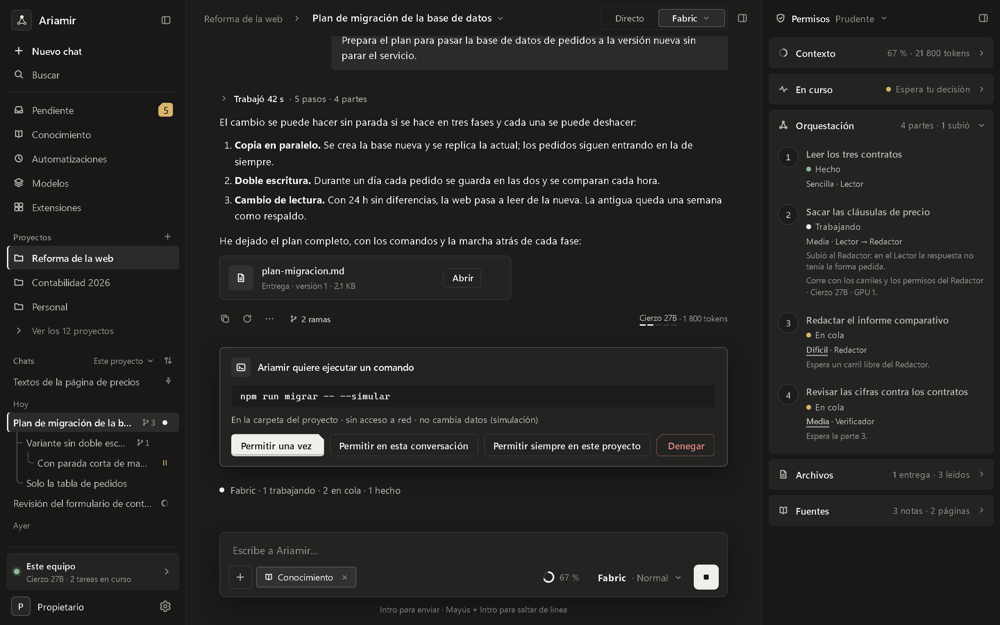](media/screenshots/interface/03-conversation-fabric-roles.png)

*In Fabric, a fixed group of roles shares the work. The conversation panel shows the orchestration as numbered parts: what each one does, its state, its difficulty and the role that runs it, including a part that moved up to a stronger role. A live line under the answer counts the roles working, queued and done.*

### Modular and configurable

*The orchestration is edited in one window: each role has its model, where it runs, its lanes and the hardest task it receives, and the memory of every GPU and of the system is shown before anything changes. Roles can be added, and nothing is applied until you confirm.*

  <a href="media/screenshots/interface-preview/fabric-role-editor.png">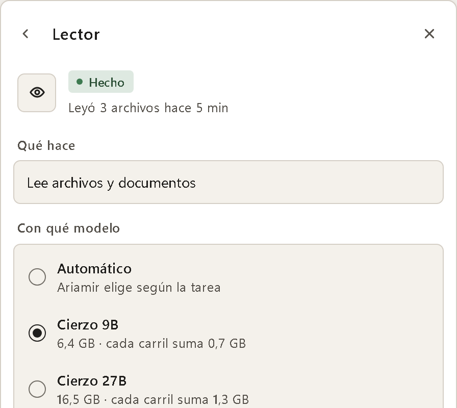</a>

*Each role describes its responsibility and its model: automatic, or fixed to an installed model, with the memory that model and every extra lane take.*

### More of the new interface

  <a href="docs/interface-tour.md">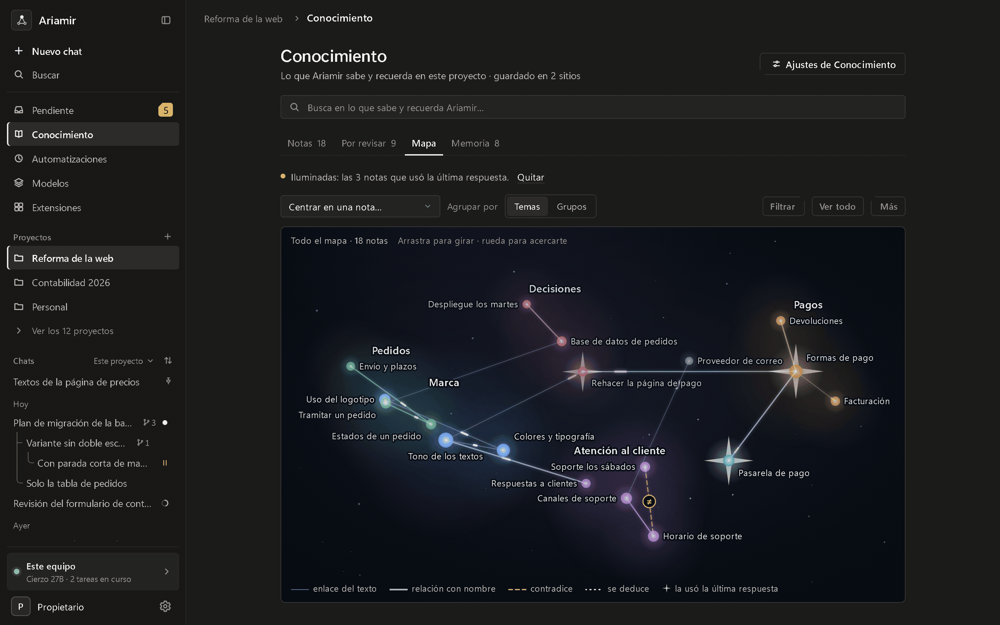</a>
  <a href="docs/interface-tour.md">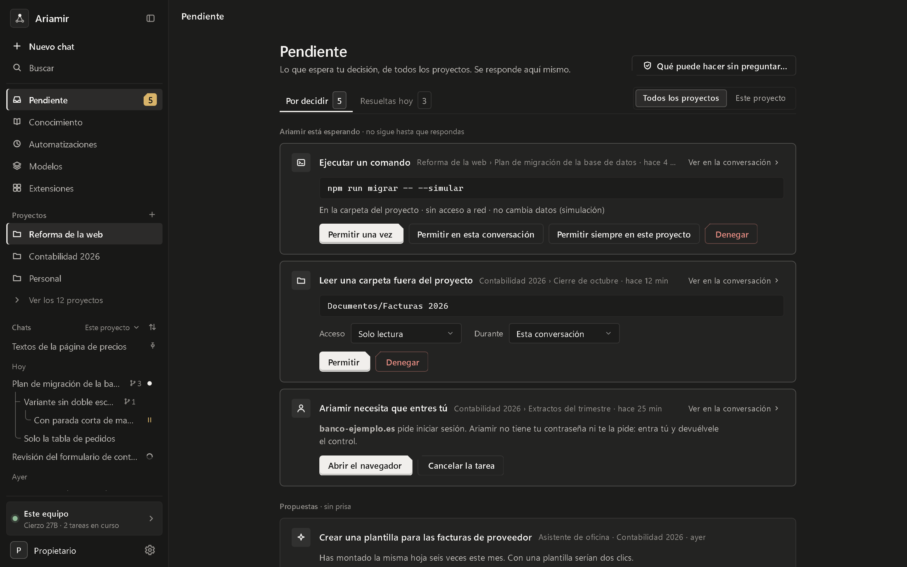</a>

  <a href="docs/interface-tour.md">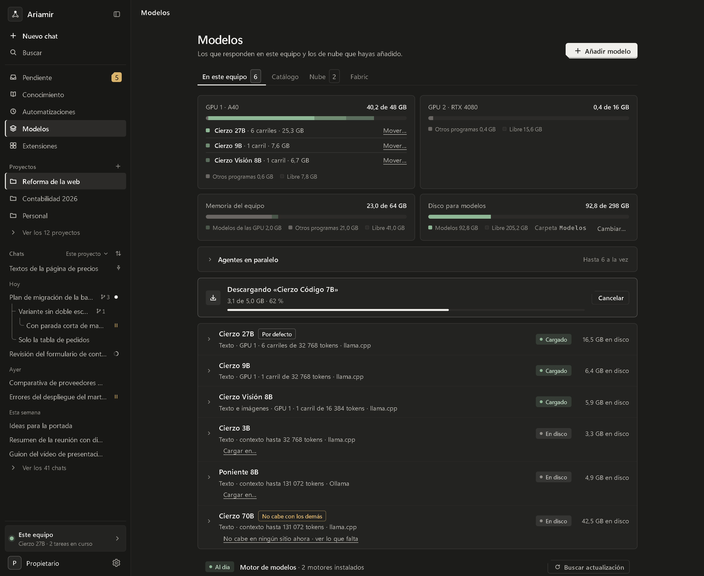</a>
  <a href="docs/interface-tour.md">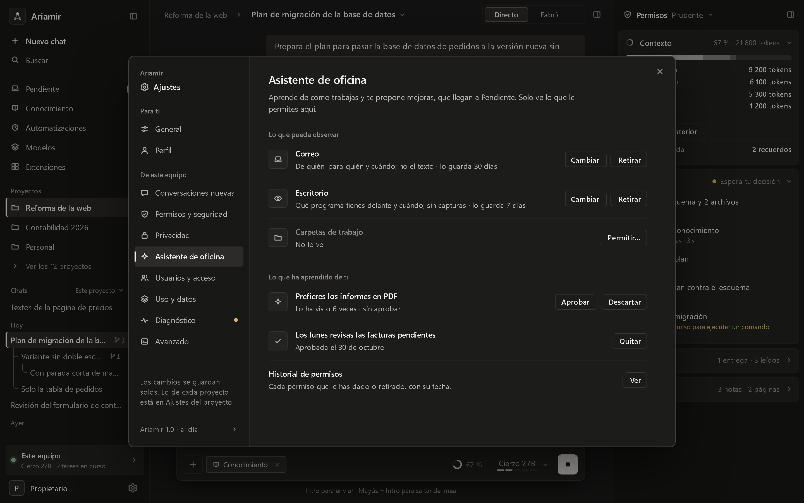</a>

  <a href="docs/interface-tour.md">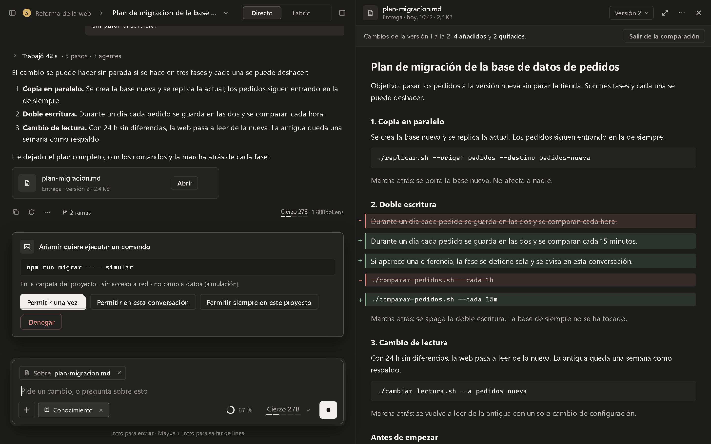</a>
  <a href="docs/interface-tour.md">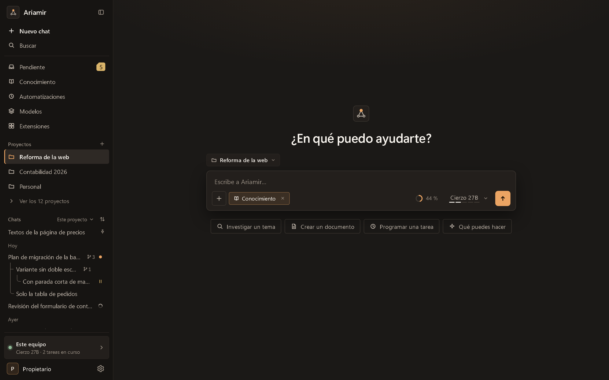</a>

*Design preview with sample data; not a release and not a validation result.* [Take the full tour: 24 full-window captures and 33 close-ups, zone by zone](docs/interface-tour.md), or read the shorter [What's new — November 2026](docs/whats-new-2026-11.md).

## AAOS — a virtual office for training and evaluation

AAOS is a simulated company with 154 synthetic people, used as a training and evaluation environment for Ariamir. Ariamir takes a seat and is intended to see only what the person in that role would see. The environment is still in development; full application integration and effective assistance during a working day remain to be validated.

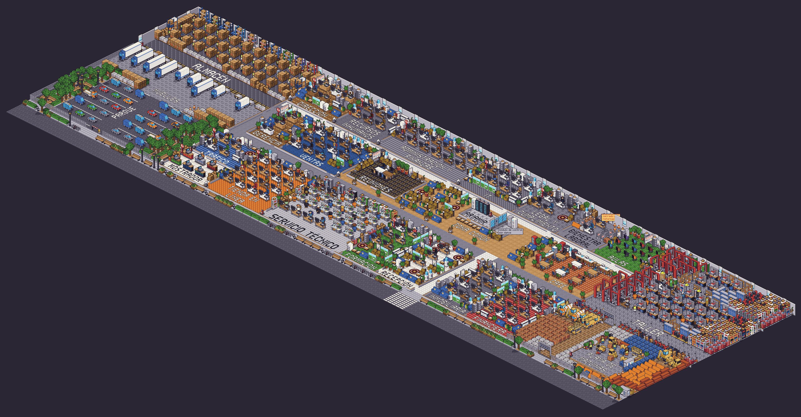

[Explore the AAOS public showcase](https://github.com/remixazkA/aaos-gym).

## The Nebrae Collective website

[nebrae.com](https://nebrae.com) presents Ariamir as a journey through a living neural network. Each chapter opens from a glass panel into an interactive world of its own, and the journey ends in a laboratory where the network keeps growing.

  <a href="media/website/nebrae-chapters.jpg">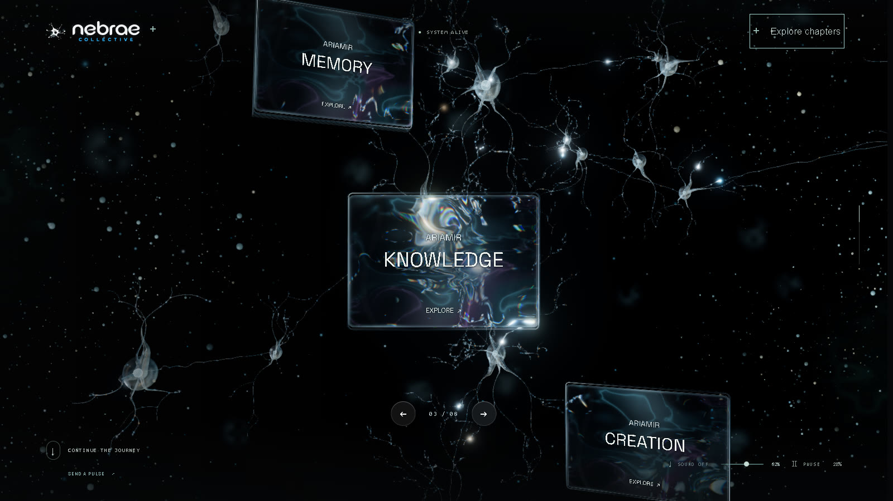</a>
  <a href="media/website/nebrae-closing.jpg">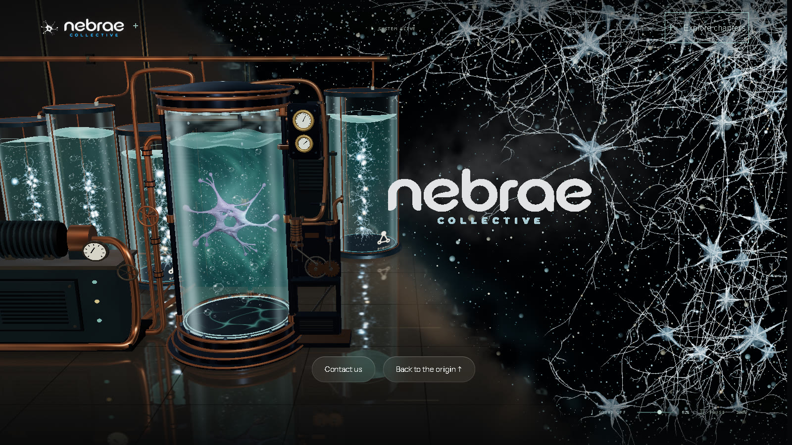</a>

*Captured from nebrae.com on 16 October 2026. The website presents the project; it is not the application.*

## Knowledge that stays connected to its sources

Knowledge gives project notes, documents, decisions and relationships a durable home. Graph Workspace makes those connections explorable. Source references help a person assess an answer; finding a note does not make its contents true.

Memory serves a different purpose: conversational continuity and preferences. Knowledge Learning prepares changes for review. Neither repeated retrieval nor a generated answer is a substitute for independent evidence.

[Explore Knowledge, Graph Workspace and learning](docs/knowledge.md).

## Illustrative workflows

These are fictional examples of intended user experience, not recorded demonstrations.

| Situation | Illustrative experience | Human checkpoint |
| --- | --- | --- |
| Prepare a project brief | Find relevant sources, inspect references and draft a report. | Review the claims and document before sharing. |
| Decide the next step | Ask for help, inspect a proposal and correct or accept it. | Authorize an operation separately if execution is wanted. |
| Extend a workspace | Add a suitable business module and work with its project data. | Review access and update/recovery options; actual module availability varies. |

## Hardware Compatibility Lab

The published reference workstation uses an Intel Core i7-12700KF, NVIDIA GeForce RTX 4080 16 GB, 32 GB RAM and Windows 11 x64; development builds currently target Windows 11. It is a development baseline, not a minimum specification or a performance guarantee.

The lab's scope includes compatibility, latency, memory pressure and workload suitability. FPGA and other accelerator work remains exploratory. No completed FPGA backend or unpublished performance result is claimed here.

[Hardware Lab](docs/hardware-lab.md) · [Benchmark methodology](benchmarks/README.md)

## Public scope

This repository is Ariamir's public showcase. It contains product descriptions, interface previews, roadmap and hardware-validation material. It does not distribute the application, proprietary source or internal architecture.

Public descriptions focus on what people can do and what remains to be validated. Private plans, contracts, prompts, routing and permission logic, credentials, customer data and operational records remain outside this repository. See the [disclosure policy](docs/public-disclosure-policy.md) and [public system overview](docs/architecture-overview.md).

## Follow the work or collaborate

We are developing evaluation methods for programming tasks and simulated office work. We welcome research and compute partners for systematic, reproducible campaigns with more variants and repetitions than the lab hardware allows.

- Visit [nebrae.com](https://nebrae.com), Nebrae Collective's interactive website.
- Follow the [dated status](docs/current-status.md), [changelog](CHANGELOG.md) and [roadmap](docs/roadmap.md).
- See [contribution guidance](CONTRIBUTING.md) for documentation and compatibility feedback.
- Explore [hardware evaluation and validation partnerships](partners/README.md).

Enterprise deployment and Android support remain exploratory; existing module access controls do not imply a finished Enterprise edition. Public release readiness, new demonstration evidence and repeatable benchmarks are still work ahead.

The showcase is not an open-source release of Ariamir. See the [license](LICENSE).
