# What's new — November 2026

*Captured 13 November 2026.*

> **Design preview.** Every image on this page comes from a navigable design prototype of the new Ariamir interface, not from an installed release. The prototype runs on sample data: project names, conversations, GPU names, memory figures, model names and times are examples. The interface text is shown in Spanish, as captured. Nothing here is a benchmark result, a guaranteed capacity or a statement that a feature has completed validation. See the [dated status](current-status.md) and the [disclosure policy](public-disclosure-policy.md).

The new interface is documented in a user manual that follows the same prototype. The pictures below show what has changed in how Ariamir looks and what it asks of you.

## The workspace

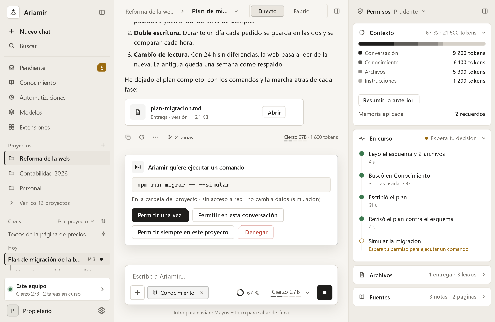

*Design preview. The sidebar, the conversation and the conversation panel. The panel shows the context used, in tokens and by source, the steps taken so far, and the files and sources behind the conversation. When Ariamir needs permission to run a command, a card in the conversation explains what it wants and offers four choices.*

## Fabric: orchestration and roles

In Fabric, the work is done by an **orchestration**: a fixed group of **roles**, each with its own model. One role coordinates; others read, write, check or program. The word *agents* is kept for the sub-tasks of Direct mode.

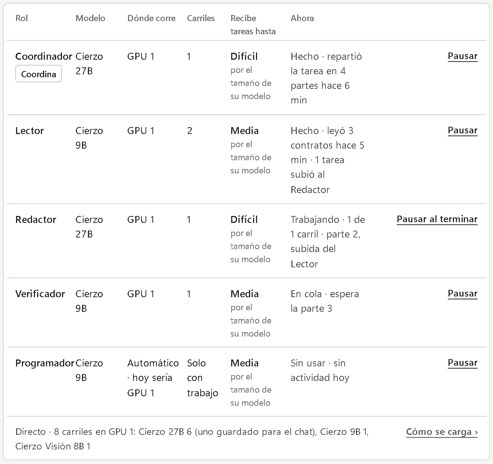

*Design preview. Each role shows its model, where it runs (a GPU or the CPU), its lanes and what it is doing now. The role that coordinates carries a label.*

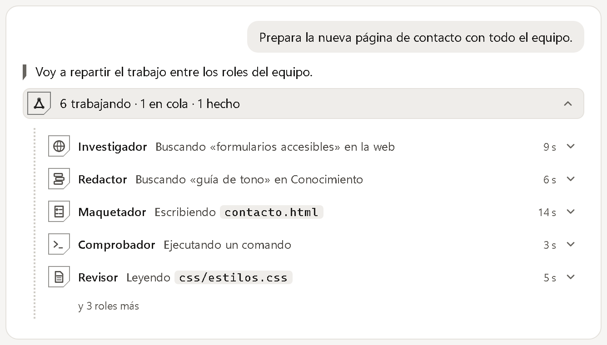

*Design preview. In a conversation, one live line counts the roles that are working, queued or done; unfolding it lists them with their current step.*

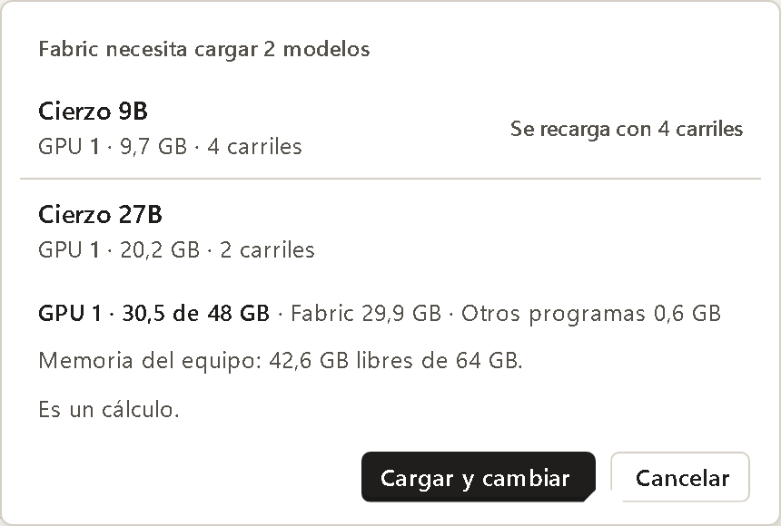

*Design preview. Before switching to Fabric, Ariamir says which models it would load and what that takes from the GPU and from system memory. The figure is labelled as a calculation, and the switch happens only after you confirm.*

## Questions from Ariamir

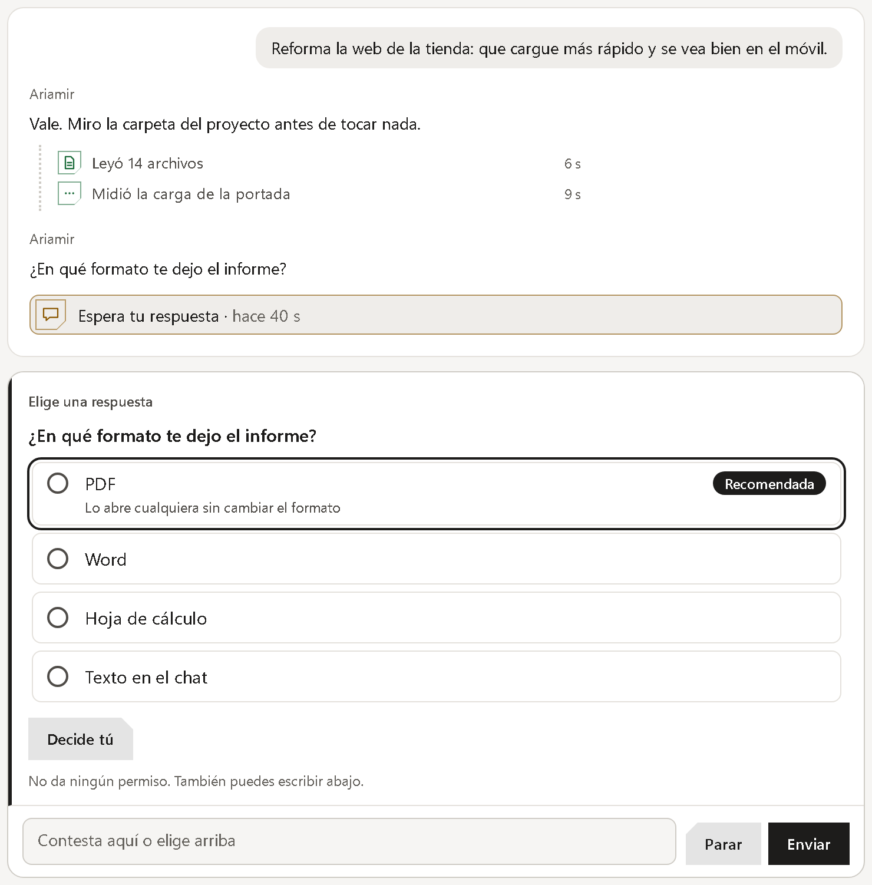

*Design preview. When Ariamir needs a decision, it asks inside the conversation. A recommended answer comes first and gives its reason. Answering does not grant any permission, and you can also type your own reply.*

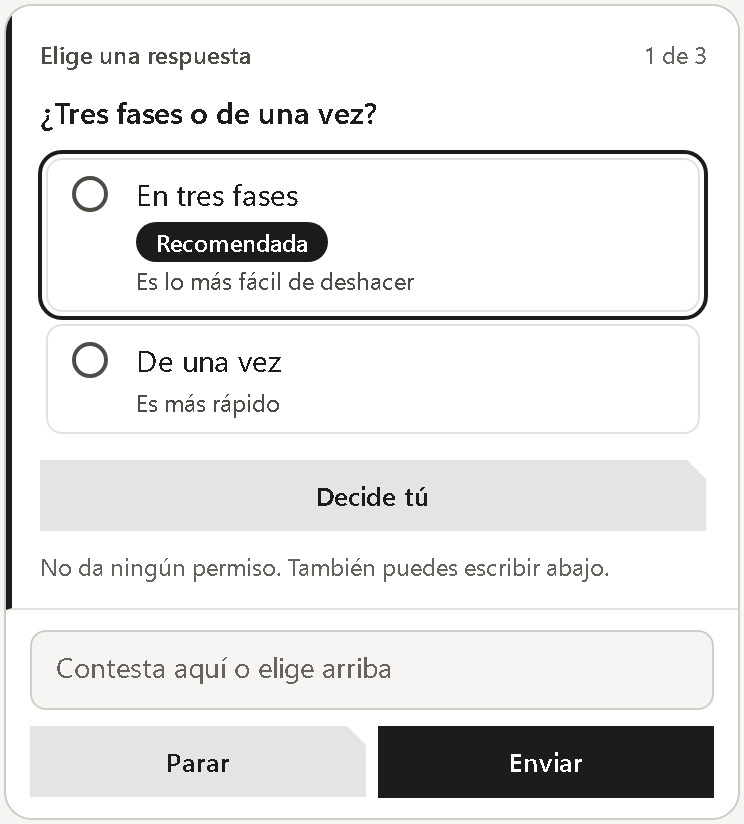

*Design preview. Several questions in a row are shown one at a time, with a counter.*

## Response style and defaults

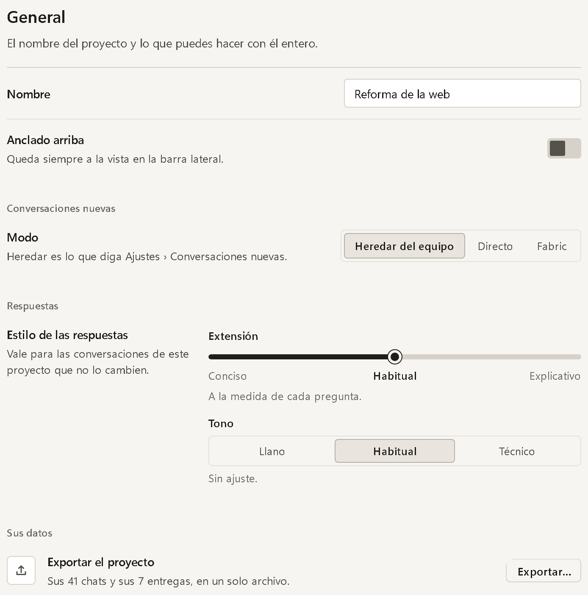

*Design preview. The style of the answers is set per project: extension from Concise to Usual to Explanatory, and tone. It is a leaning, not a quota; each question is still answered on its own terms.*

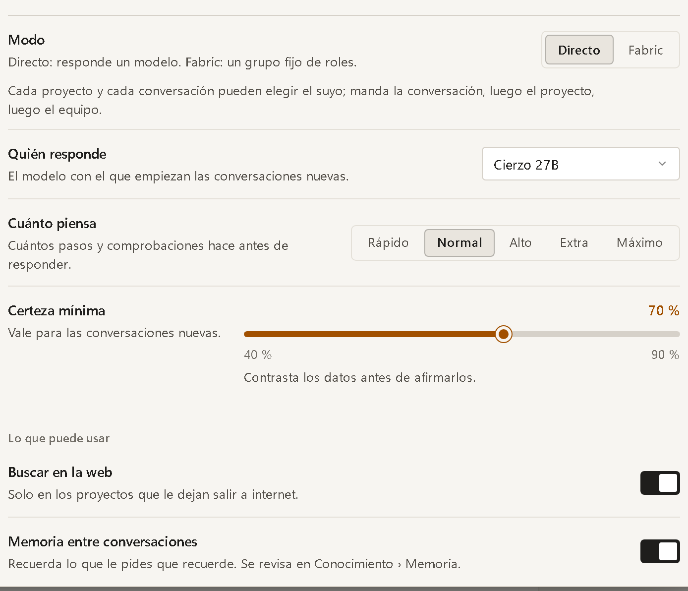

*Design preview. Defaults for new conversations: Direct or Fabric, the model that starts them, how much Ariamir thinks before answering, and a minimum-certainty setting between 40 % and 90 %. The certainty setting is a level of checking effort, not a probability that an answer is correct.*

## The office assistant: sources and consent

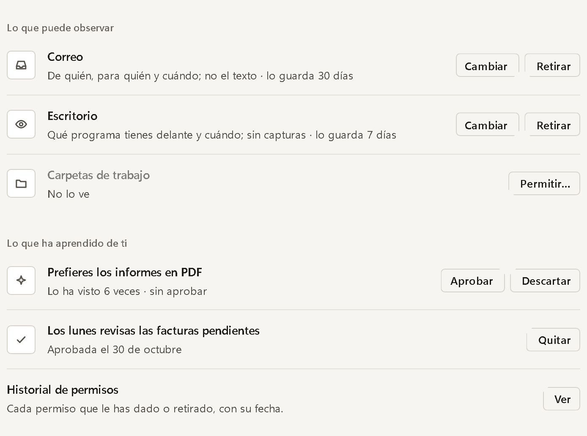

*Design preview. The office assistant lists what it may observe, what each source records and how long it keeps it. Sources that are not allowed say so. What it has learned is shown as suggestions you can approve, discard or remove, and every permission can be reviewed in a history.*

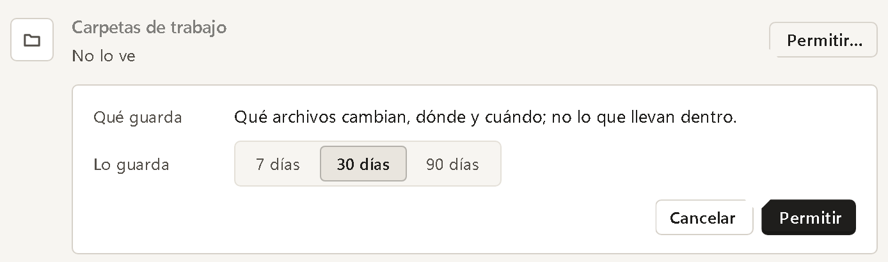

*Design preview. Allowing a source is an explicit step that states what is recorded and lets you choose the retention period first.*

## GPUs and models, drawn from the machine

The interface does not assume a fixed machine. GPUs, memory and models are drawn from what the computer reports: no GPU, one, or several. The names below are examples.

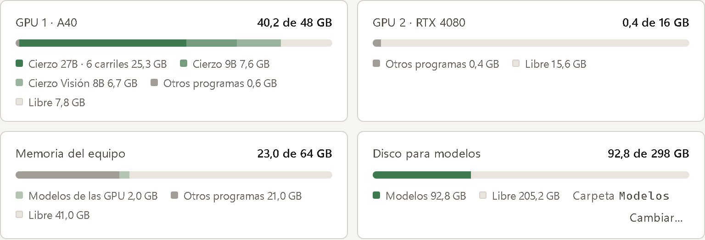

*Design preview. One meter per GPU, one for system memory and one for the disk that holds the models. Each splits memory into what the loaded models use, what other programs use and what is free.*

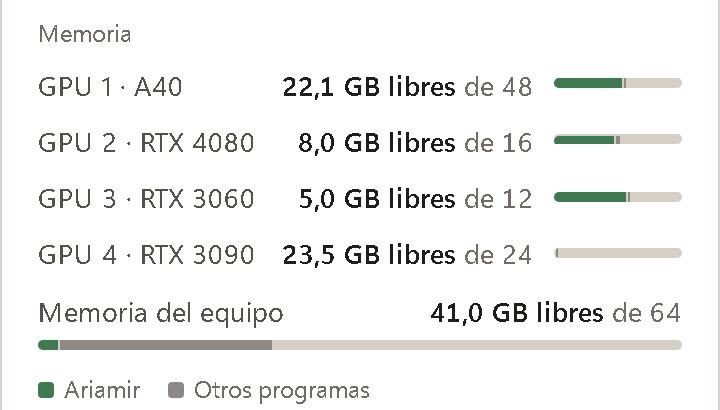

*Design preview. A machine with four GPUs, shown as one compact row each. The same menu adapts to a machine with none.*

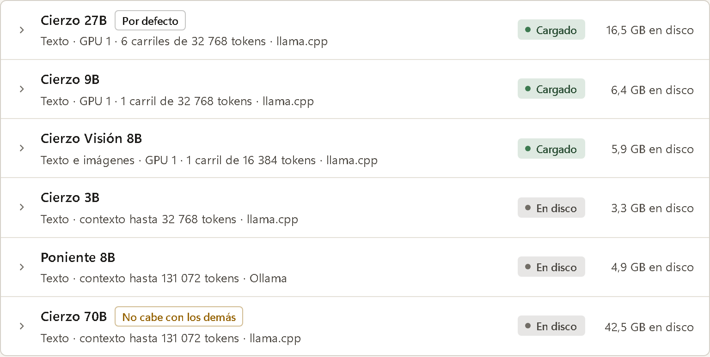

*Design preview. The model list shows what each model accepts, where it is loaded, how many lanes and how many tokens of context each has, the engine, its state and its size on disk. A model that does not fit alongside the others is flagged.*

## Boundaries

- These views are a design preview. Availability in a given build depends on the build and configuration.
- Sample data and example names stand in for real projects, machines and models.
- Capacity, responsiveness and accuracy still need validation on real workloads; see the [roadmap](roadmap.md).
