# What's new — November 2026

## Update — 18 November 2026

*Reviewed 18 November 2026.*

> **Status of this update.** The captures in this update are a design preview of the interface on sample data (interface text in Spanish; GPU names, models, projects and figures are examples). The capabilities they show are **in validation** on a development branch. They are **not part of the installed release**, and none of this is a benchmark result or a statement that validation is complete. See the [dated status](current-status.md).

Since 13 November the interface work has moved from how Ariamir looks to how it is set up and controlled on a real machine.

### Orchestration by team: roles and templates

An orchestration is built from **roles**. Each role shows what it does, its model and lane, the hardest task it accepts, its status and a pause button. **Templates** (office, programming, research, data, minimal) propose a set of roles and lanes, and say whether the set fits in the free GPU memory before anything is applied.

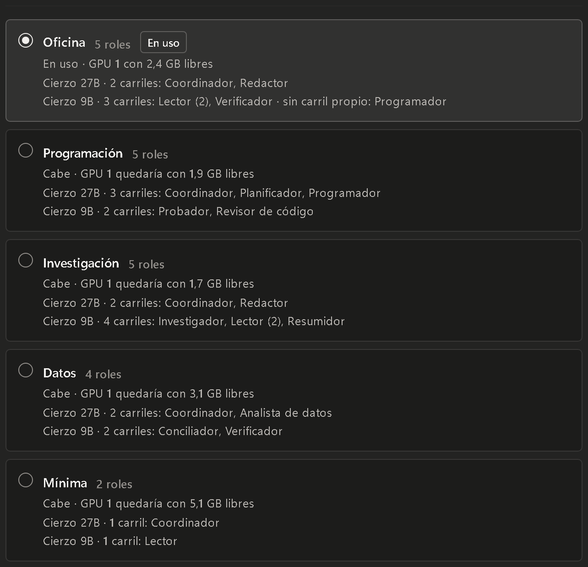

*Design preview. Orchestration templates (office, programming, research, data, minimal): their roles and lanes, and whether they fit in free GPU memory.*

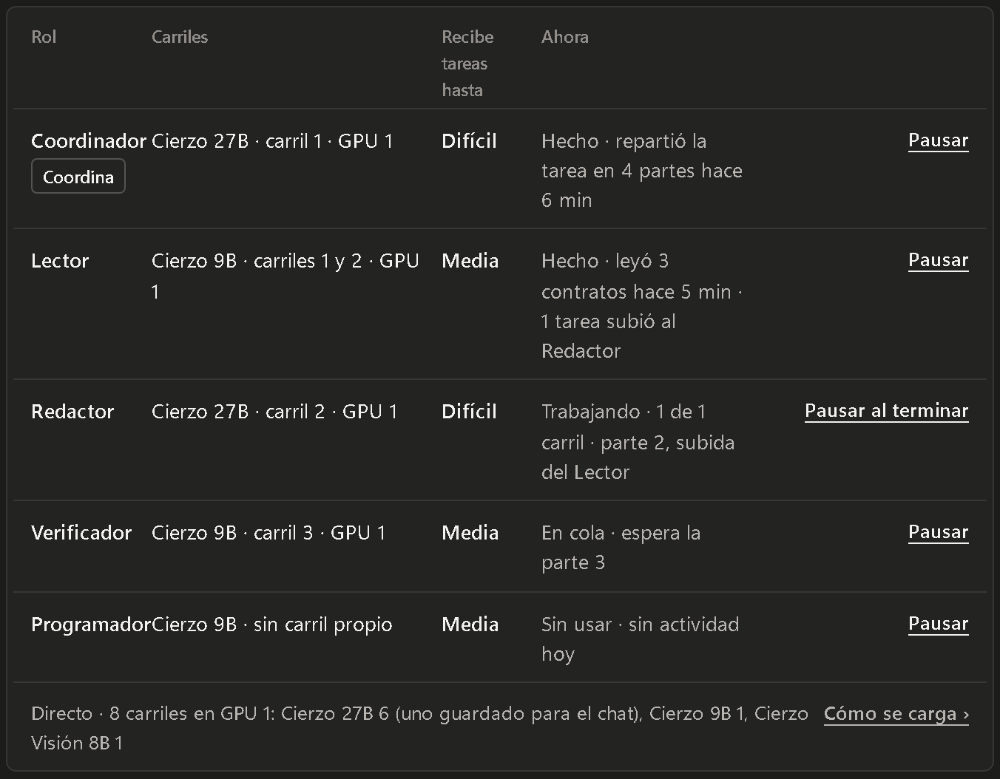

*Design preview. Orchestration roles: what each one does, its model and lane, the hardest task it accepts, its status and a pause button.*

### Lanes per GPU, each with its own context

A model can serve several parallel **lanes**. Each lane has its own context, set with its own slider, and the screen shows how much of the GPU's total context the lanes use together.

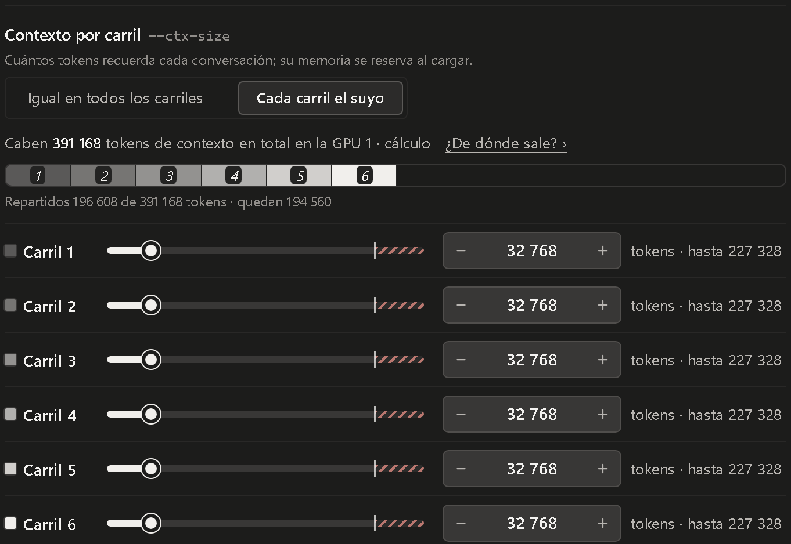

*Design preview. Each lane with its own context: one slider per lane, and how much of the GPU's total context they use.*

### Fine engine settings (Advanced)

For people who want to go further, an **Advanced** area exposes 22 fine settings of the inference engine, in groups, each with the engine flag it sets and whether it has been measured on this computer.

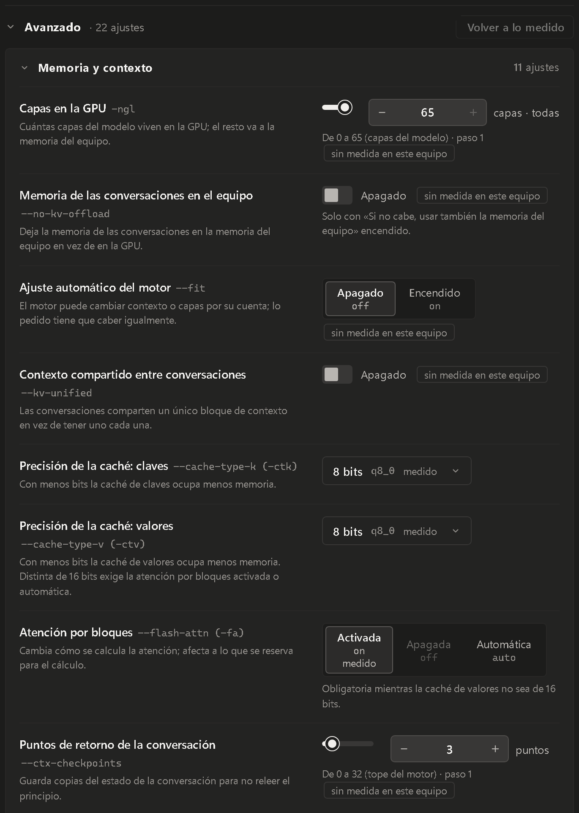

*Design preview. Advanced: 22 fine settings of the inference engine, in groups, each with its flag and whether it has been measured on this computer.*

### Test two configurations

**Test** puts two configurations side by side, with their memory and speed. It says plainly that it does not measure answer quality.

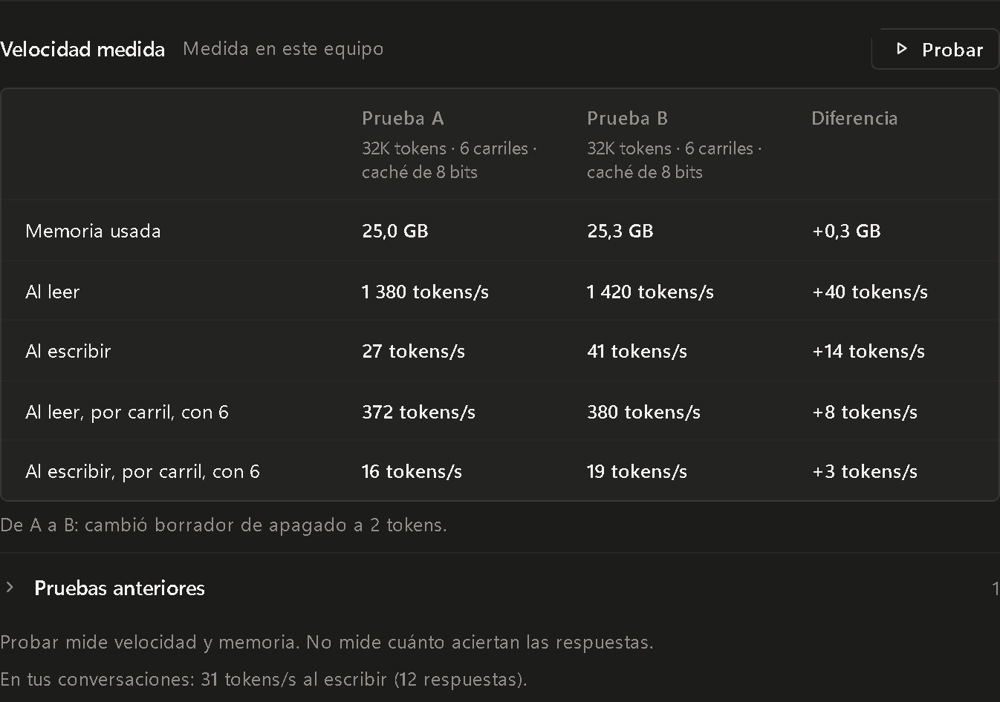

*Design preview. Test: two configurations side by side, with memory and speed. It says plainly that it does not measure answer quality. Sample figures.*

### This computer

A compact panel, **This computer**, lists the running tasks, the loaded models, the memory of each GPU and of the system, and offers **Stop all**.

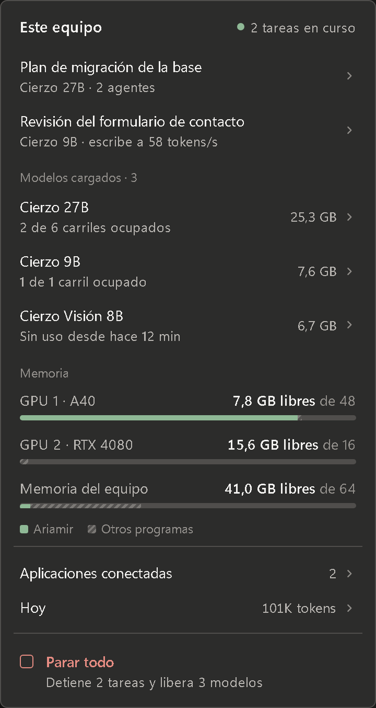

*Design preview. «This computer»: running tasks, loaded models, the memory of each GPU and the system, and «Stop all». Sample figures.*

### Permissions per project

Each project has one of three permission levels, a summary of what the chosen level allows, and fine adjustments.

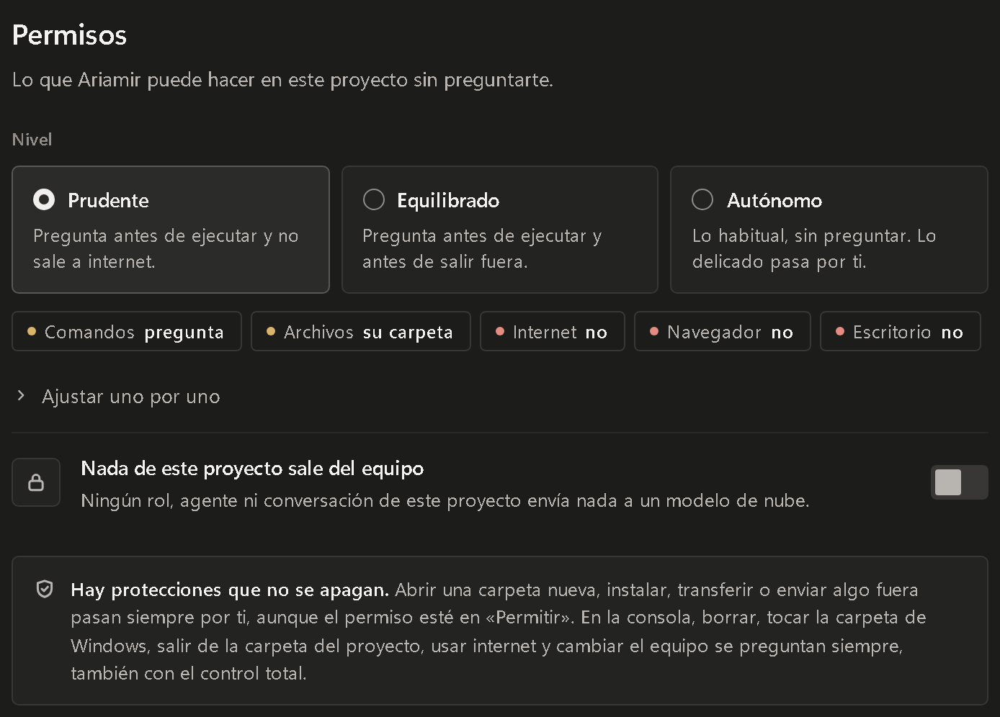

*Design preview. Project permissions: three levels, a summary of what the chosen one allows, and fine adjustments.*

### Knowledge map

The **knowledge map** draws each topic as a cluster of notes joined by relations, and highlights the notes used by the last answer.

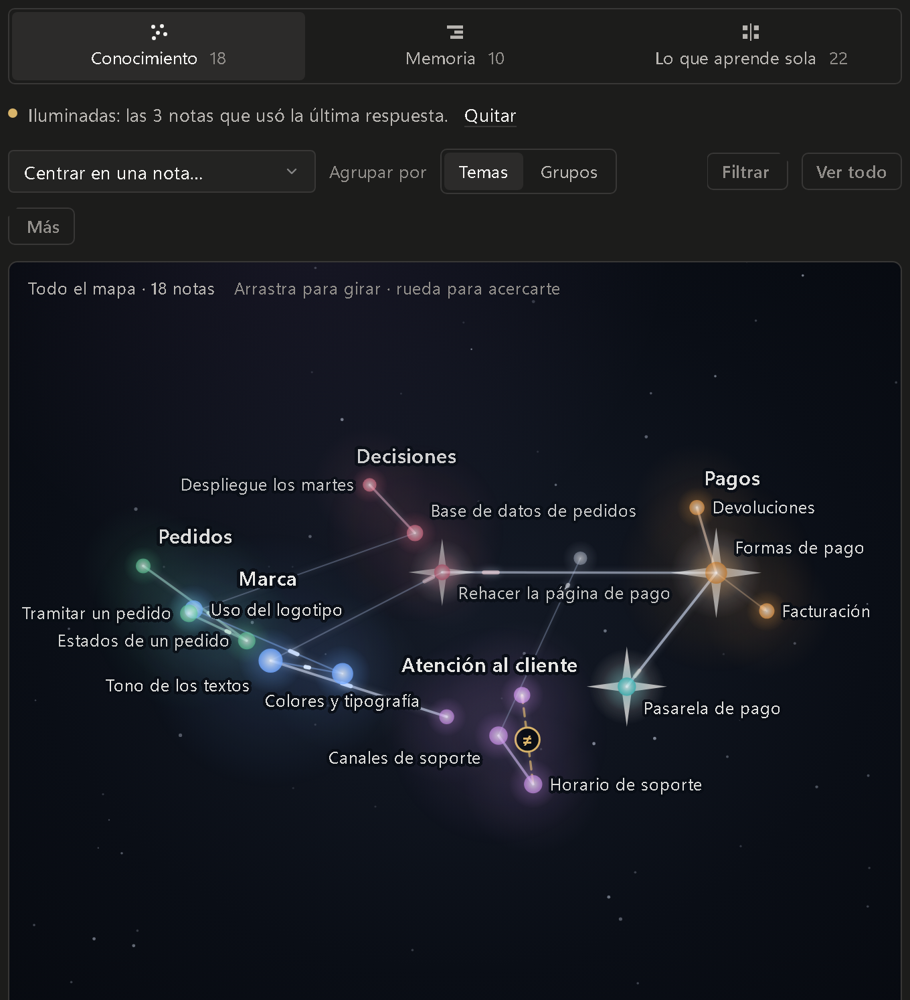

*Design preview. Knowledge map: each topic is a cluster of notes, the lines are relations, and the notes used by the last answer are highlighted.*

### Office assistant

The office assistant only observes the sources the person allows, and each one can be allowed, changed or withdrawn. See [the captures below](#the-office-assistant-sources-and-consent).

### Status of the 18 November update

| Capability | Status |
| --- | --- |
| Orchestration by team: roles and templates | In validation (development branch) |
| Lanes with their own context | In validation (development branch) |
| Advanced engine settings, Test, This computer | In validation (development branch) |
| Permissions per project | In validation (development branch) |
| Knowledge map and office assistant | In validation (development branch) |

Capacity, speed and accuracy on real workloads still need validation; see the [roadmap](roadmap.md).

---

## 13 November 2026 — the new interface

*Captured 13 November 2026.*

> **Design preview.** Every image on this page comes from a navigable design prototype of the new Ariamir interface, not from an installed release. The prototype runs on sample data: project names, conversations, GPU names, memory figures, model names and times are examples. The interface text is shown in Spanish, as captured. Nothing here is a benchmark result, a guaranteed capacity or a statement that a feature has completed validation. See the [dated status](current-status.md) and the [disclosure policy](public-disclosure-policy.md).

The new interface is documented in a user manual that follows the same prototype. The pictures below show what has changed in how Ariamir looks and what it asks of you. For the whole interface, zone by zone, with full-window captures, see the [interface tour](interface-tour.md).

## The workspace

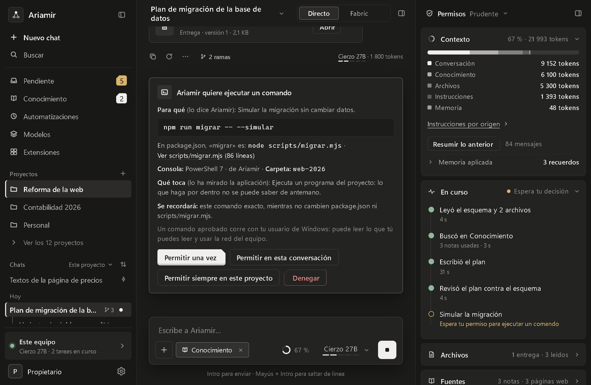

*Design preview. The sidebar, the conversation and the conversation panel. The panel shows the context used, in tokens and by source, the steps taken so far, and the files and sources behind the conversation. When Ariamir needs permission to run a command, a card in the conversation explains what it wants and offers four choices.*

## Fabric: orchestration and roles

In Fabric, the work is done by an **orchestration**: a fixed group of **roles**, each with its own model. One role coordinates; others read, write, check or program. The word *agents* is kept for the sub-tasks of Direct mode.

*Design preview. Each role shows the model and lane it uses and the GPU it runs on, the hardest tasks it receives, what it is doing now and a pause button. The role that coordinates carries a label, and a role can have no lane of its own.*

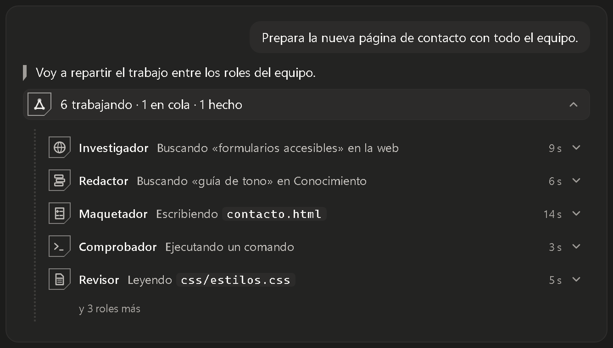

*Design preview. In a conversation, one live line counts the roles that are working, queued or done; unfolding it lists them with their current step.*

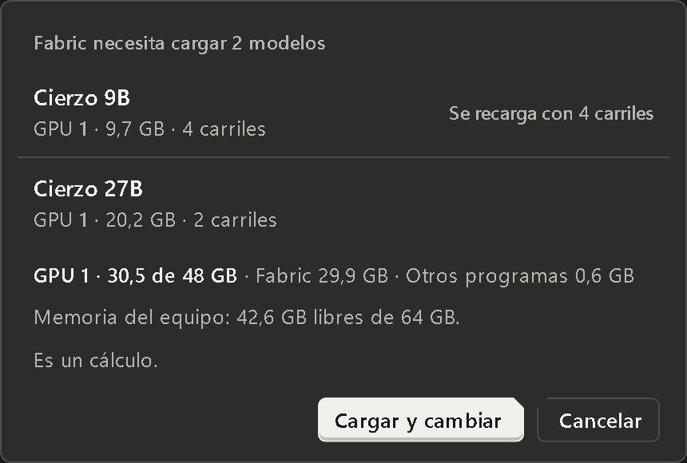

*Design preview. Before switching to Fabric, Ariamir says which models it would load and what that takes from the GPU and from system memory. The figure is labelled as a calculation, and the switch happens only after you confirm.*

## Questions from Ariamir

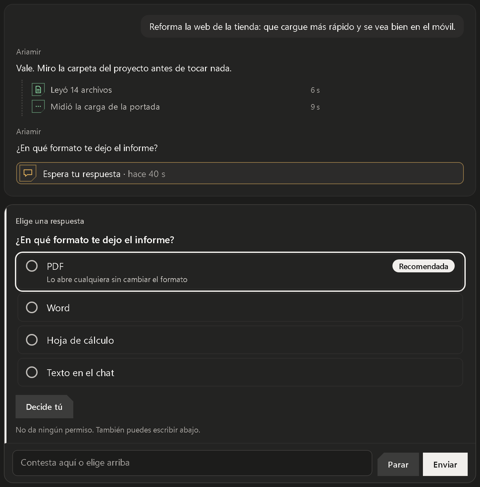

*Design preview. When Ariamir needs a decision, it asks inside the conversation. A recommended answer comes first and gives its reason. Answering does not grant any permission, and you can also type your own reply.*

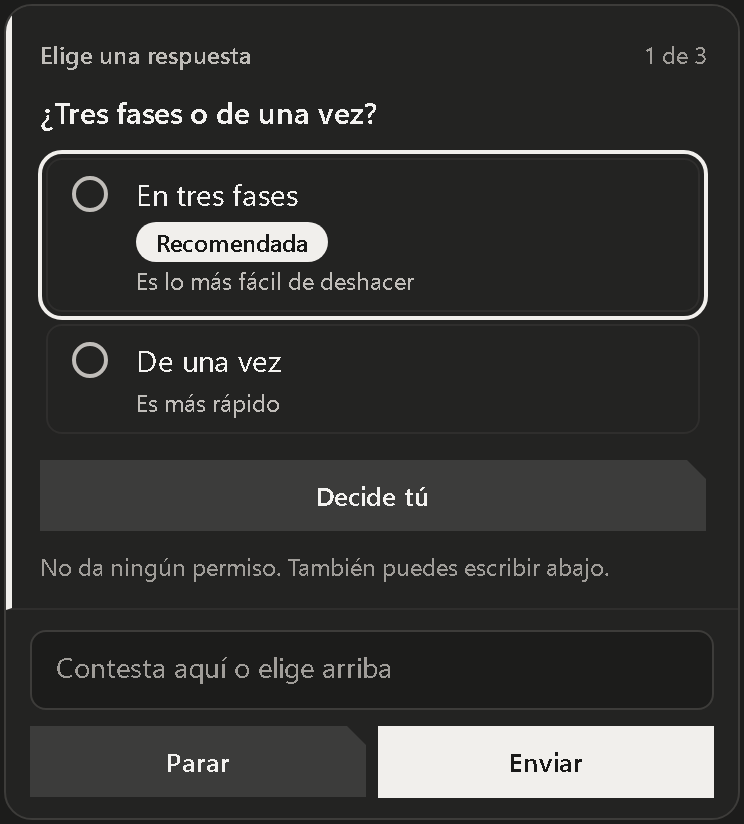

*Design preview. Several questions in a row are shown one at a time, with a counter.*

## Response style and defaults

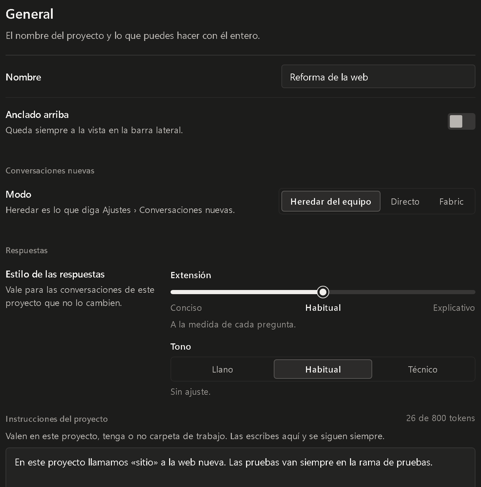

*Design preview. The style of the answers is set per project: extension from Concise to Usual to Explanatory, and tone. It is a leaning, not a quota; each question is still answered on its own terms.*

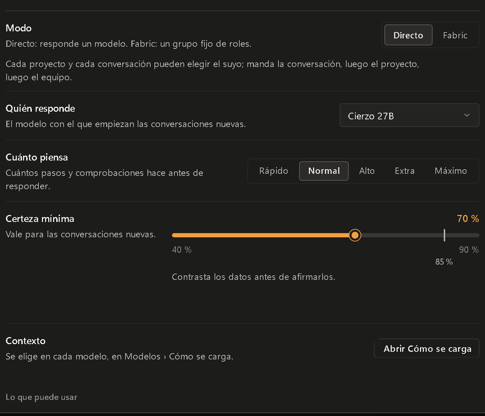

*Design preview. Defaults for new conversations: Direct or Fabric, the model that starts them, how much Ariamir thinks before answering, and a minimum-certainty setting between 40 % and 90 %. The certainty setting is a level of checking effort, not a probability that an answer is correct.*

## The office assistant: sources and consent

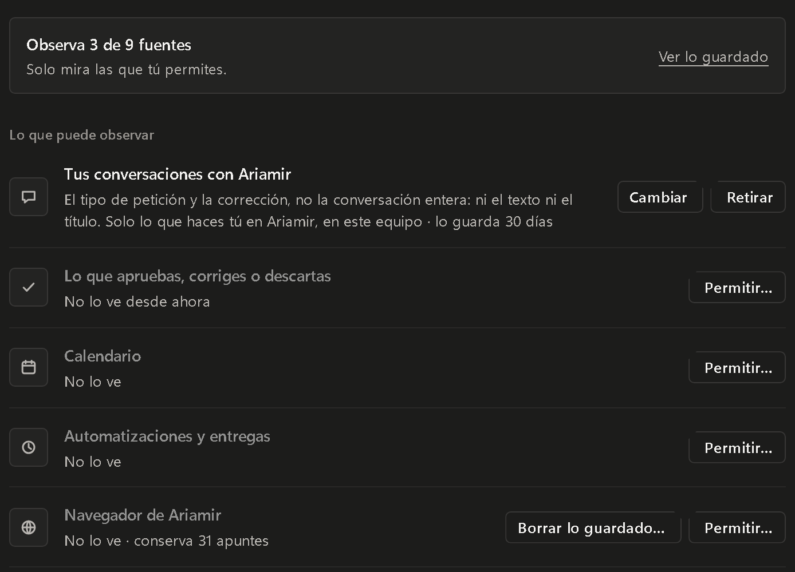

*Design preview. The office assistant lists what it may observe, what each source records and how long it keeps it. Sources that are not allowed say so. What it has learned is shown as suggestions you can approve, discard or remove, and every permission can be reviewed in a history.*

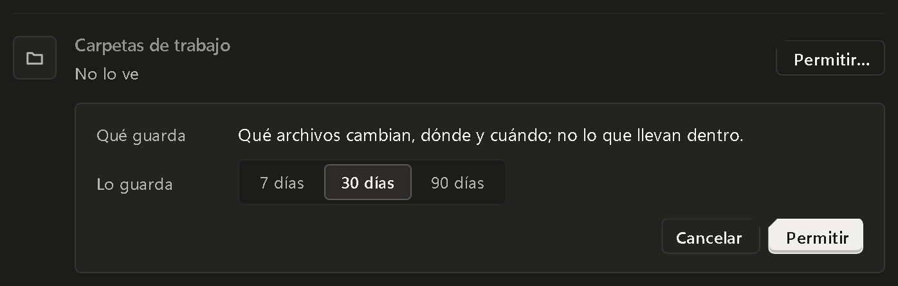

*Design preview. Allowing a source is an explicit step that states what is recorded and lets you choose the retention period first.*

## GPUs and models, drawn from the machine

The interface does not assume a fixed machine. GPUs, memory and models are drawn from what the computer reports: no GPU, one, or several. The names below are examples.

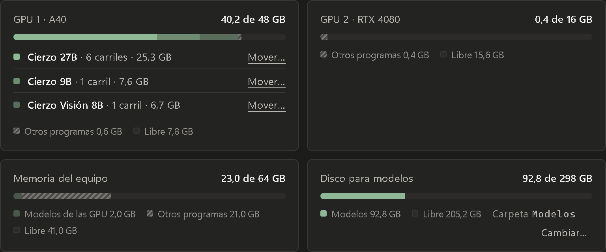

*Design preview. One meter per GPU, one for system memory and one for the disk that holds the models. Each splits memory into what the loaded models use, what other programs use and what is free.*

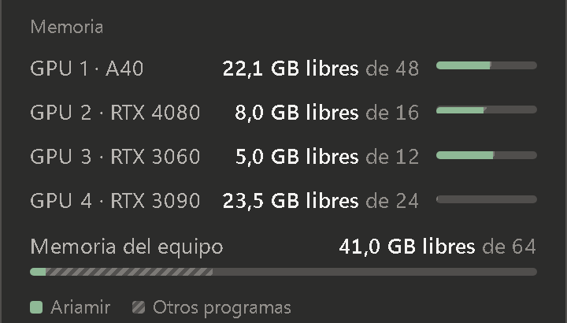

*Design preview. A machine with four GPUs, shown as one compact row each. The same menu adapts to a machine with none.*

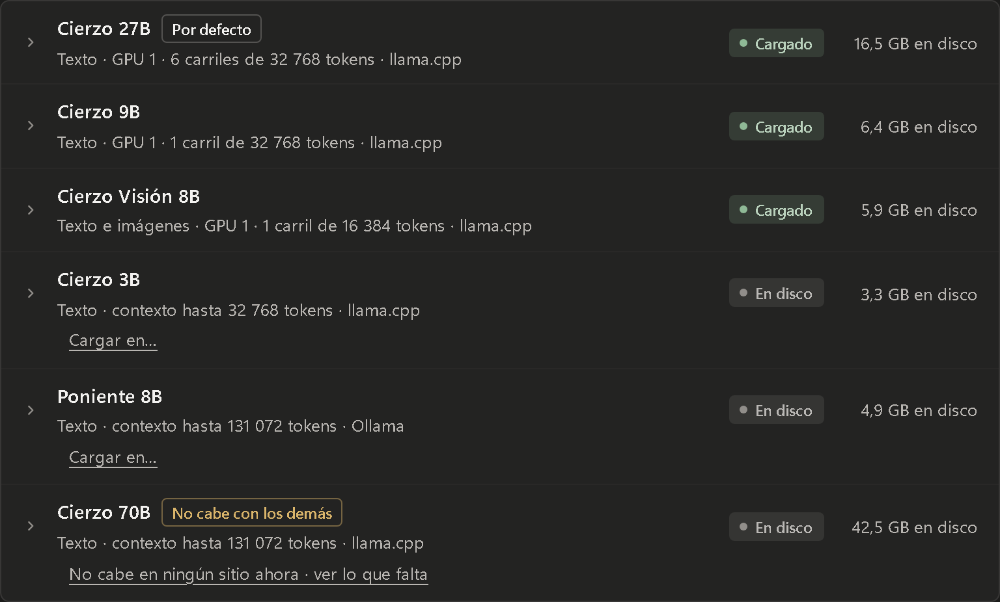

*Design preview. The model list shows what each model accepts (text, or text and images), the engine, its state and its size on disk. A loaded model also shows its GPU and how many lanes of how many tokens it has; a model on disk shows the largest context it supports and a link to load it. One model is marked as the default, and one that does not fit alongside the others is flagged.*

## Boundaries

- These views are a design preview. Availability in a given build depends on the build and configuration.
- Sample data and example names stand in for real projects, machines and models.
- Capacity, responsiveness and accuracy still need validation on real workloads; see the [roadmap](roadmap.md).
